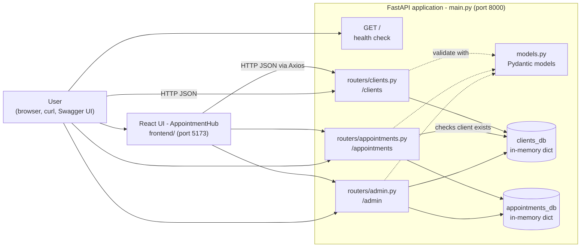
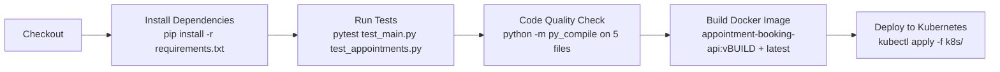

# Client Appointment Booking System

> **DevOps Lab Mini Project** · Final-year B.Tech (Computer Science & Engineering) · 10-member team
>
> A FastAPI REST API (with an optional React web UI) for registering clients, booking appointments and managing them as an administrator, delivered with Pytest tests, a Jenkins pipeline, Docker images and Kubernetes manifests.

---

## Table of Contents

1. [Overview](#1-overview)
2. [Problem Statement](#2-problem-statement)
3. [Objectives](#3-objectives)
4. [Implemented Features](#4-implemented-features)
5. [Technology Stack](#5-technology-stack)
6. [Architecture Overview](#6-architecture-overview)
7. [Repository Structure](#7-repository-structure)
8. [Prerequisites](#8-prerequisites)
9. [Installation & Setup](#9-installation--setup)
10. [Running the Application Locally](#10-running-the-application-locally)
11. [API Reference](#11-api-reference)
12. [Example Requests & Responses](#12-example-requests--responses)
13. [Running the Tests](#13-running-the-tests)
14. [Docker](#14-docker)
15. [Jenkins CI/CD Pipeline](#15-jenkins-cicd-pipeline)
16. [Kubernetes Deployment](#16-kubernetes-deployment)
17. [Verifying the Application Is Running](#17-verifying-the-application-is-running)
18. [Troubleshooting](#18-troubleshooting)
19. [Team & Responsibilities](#19-team--responsibilities)
20. [Further Documentation](#20-further-documentation)
21. [Limitations & Future Enhancements](#21-limitations--future-enhancements)
22. [Conclusion](#22-conclusion)

---

## 1. Overview

The **Client Appointment Booking System** lets a service business (a clinic, salon, consultancy, etc.) keep track of its clients and their appointments through a simple HTTP API.

- **Clients** are registered with an ID, name, email, phone number and registration timestamp.
- **Appointments** are booked for an existing client with a service type, date and time. They start in the `pending` status.
- **Administrators** can change an appointment's status (for example to `confirmed` or `cancelled`), delete appointments or clients, and view summary statistics on a dashboard.

The backend is written in **Python with FastAPI**. A **React + Vite** web interface (*AppointmentHub*) in [`frontend/`](frontend/) calls the same API. Around the application, the repository contains the DevOps assets this lab focuses on: a **Pytest** suite, a **Jenkinsfile**, **Dockerfiles** with **Docker Compose**, and **Kubernetes** manifests.

> **Data storage:** all data is kept **in memory** (Python dictionaries). There is no database, so everything is lost when the server restarts. This is deliberate for a lab project; see [Limitations](#21-limitations--future-enhancements).

## 2. Problem Statement

Many small service providers still manage bookings with phone calls, paper registers or spreadsheets. This leads to:

- double-booked or forgotten appointments,
- no single, reliable list of clients,
- no quick way to see how many appointments are pending, confirmed or cancelled.

A small, well-tested API that stores clients and appointments, checks that a booking refers to a real client, and gives administrators a summary view solves the core of this problem. Packaging it with CI/CD, containers and orchestration shows how such a service is built and shipped by a team.

## 3. Objectives

1. Build a REST API for client registration, appointment booking and admin management.
2. Validate input automatically (required fields, correct JSON types) and return meaningful HTTP error codes.
3. Write automated tests that exercise every module.
4. Collaborate as a 10-person team through Git branches and GitHub pull requests.
5. Automate install → test → quality-check → build → deploy with a Jenkins pipeline.
6. Package the API (and the UI) as Docker images.
7. Describe a Kubernetes Deployment and Service for running the API with multiple replicas.
8. Document the project so anyone can reproduce it.

## 4. Implemented Features

Everything below was verified by reading the source code and by running the test suite (see [Section 13](#13-running-the-tests)).

| Area | Feature | Source |
|---|---|---|
| System | Health check at `GET /` | [`main.py`](main.py) |
| System | Interactive API docs (Swagger UI at `/docs`, ReDoc at `/redoc`), generated automatically by FastAPI | [`main.py`](main.py) |
| Clients | Register a client; duplicate `client_id` → `400` | [`routers/clients.py`](routers/clients.py) |
| Clients | List all clients; get a client by ID (`404` if missing) | [`routers/clients.py`](routers/clients.py) |
| Appointments | Book an appointment; the client must exist (`404`), the `appointment_id` must be unique (`400`) | [`routers/appointments.py`](routers/appointments.py) |
| Appointments | Default status is `pending` | [`models.py`](models.py) |
| Appointments | List all appointments; get one by ID (`404` if missing) | [`routers/appointments.py`](routers/appointments.py) |
| Admin | Update an appointment's status | [`routers/admin.py`](routers/admin.py) |
| Admin | Delete an appointment | [`routers/admin.py`](routers/admin.py) |
| Admin | Delete a client **and all of that client's appointments** | [`routers/admin.py`](routers/admin.py) |
| Admin | Dashboard: total clients, total appointments, and counts of `pending` / `confirmed` / `cancelled` | [`routers/admin.py`](routers/admin.py) |
| Validation | Missing or wrongly-typed fields → `422 Unprocessable Entity` (Pydantic) | [`models.py`](models.py) |
| Web UI | React pages: Home, Register Client, Clients, Book Appointment, Appointments, Appointment Lookup, Admin Dashboard | [`frontend/src/pages/`](frontend/src/pages/) |
| Cross-origin | CORS enabled for all origins so the UI on port 5173 can call the API on port 8000 | [`main.py`](main.py) |

**Not implemented** (do not present these as features): user login/authentication, a database, email/SMS notifications, time-slot clash detection, and validation of email/date/time formats or status values.

## 5. Technology Stack

Versions come from [`requirements.txt`](requirements.txt), [`frontend/package.json`](frontend/package.json) and the Dockerfiles.

| Layer | Technology | Why it is used |
|---|---|---|
| Language | Python (Docker image: 3.9; tested locally with 3.11) | Simple, readable, very popular for APIs |
| Web framework | **FastAPI 0.103.1** | Fast to write, automatic request validation and automatic Swagger docs |
| Data models | **Pydantic 2.3.0** | Declares the shape of `Client`, `Appointment` and `StatusUpdate`; rejects bad input with `422` |
| Server | **Uvicorn 0.23.2** | ASGI server that runs the FastAPI app |
| Testing | **Pytest 7.4.2** + **HTTPX 0.25.0** (used by FastAPI's `TestClient`) | Runs HTTP-level tests without starting a real server |
| Web UI | React 18, Vite 5, Tailwind CSS 3, Axios, React Router | Optional browser front-end for the API |
| Version control | Git + GitHub | Branches, pull requests, shared history |
| CI/CD | **Jenkins** (declarative `Jenkinsfile`) | Automates install, test, compile check, image build and deploy |
| Containers | **Docker** (multi-stage builds), **Docker Compose** | Same runtime everywhere; one command starts API + UI |
| Web server for UI | Nginx (alpine) | Serves the built React files inside the frontend container |
| Orchestration | **Kubernetes** (`Deployment` + `Service`) | Runs 2 replicas of the API with health probes and a stable network endpoint |

## 6. Architecture Overview



**How a request flows** (example: booking an appointment):

1. The client sends `POST /appointments` with a JSON body.
2. FastAPI routes it to `book_appointment()` in [`routers/appointments.py`](routers/appointments.py).
3. Pydantic converts the JSON into an `Appointment` object. Missing fields produce `422` before our code even runs.
4. The handler checks that `client_id` exists in `clients_db`. If not, it returns `404`.
5. It checks that `appointment_id` is not already in `appointments_db`. If it is, it returns `400`.
6. It stores the appointment and returns it as JSON with `200 OK`.

Module dependencies: `main.py` includes the three routers. `appointments.py` imports `clients_db` from `clients.py`. `admin.py` imports both stores. All routers import their models from `models.py`.

A deeper explanation, including CI/CD and deployment diagrams, is in [docs/Project_Architecture.md](docs/Project_Architecture.md).

## 7. Repository Structure

```text
client-appointment-booking-system/
├── main.py                     # FastAPI app: registers routers, CORS, health check (GET /)
├── models.py                   # Pydantic models: Client, Appointment, StatusUpdate
├── routers/
│   ├── __init__.py
│   ├── clients.py              # /clients endpoints + clients_db store
│   ├── appointments.py         # /appointments endpoints + appointments_db store
│   └── admin.py                # /admin endpoints (status, delete, dashboard)
├── test_main.py                # 9 integration tests against the full app
├── test_appointments.py        # 10 tests for clients + appointments routers
├── requirements.txt            # Python dependencies (pinned)
├── Jenkinsfile                 # Jenkins declarative pipeline
├── Dockerfile                  # Multi-stage image for the API
├── .dockerignore               # Keeps tests, docs, k8s, secrets out of the image
├── docker-compose.yml          # Runs API + frontend together
├── k8s/
│   ├── deployment.yaml         # Deployment: 2 replicas, probes, resource limits
│   └── service.yaml            # Service: LoadBalancer, port 80 → 8000
├── frontend/                   # React + Vite UI (AppointmentHub)
│   ├── Dockerfile              # Node build → Nginx runtime
│   ├── nginx.conf
│   ├── package.json
│   └── src/                    # pages/, components/, api/client.js, ...
├── docs/                       # Architecture, team charter, contribution audit, presentation material
├── .gitignore
└── README.md                   # This file
```

## 8. Prerequisites

| Software | Needed for | Notes |
|---|---|---|
| **Python 3.9 – 3.12** | Running the API and tests | ⚠️ Python **3.13 and 3.14 are not supported** by the pinned `pydantic==2.3.0`: there are no pre-built `pydantic-core 2.6.3` wheels, so pip tries to compile Rust code and usually fails. Tested with 3.11. |
| pip | Installing dependencies | Comes with Python |
| Git | Cloning the repository | |
| Node.js 18+ and npm | *Optional:* the React UI | The frontend Docker image uses Node 20 |
| Docker Desktop / Docker Engine | *Optional:* containers | Docker Compose v2 (`docker compose`) |
| Jenkins (2.x, Pipeline plugin) | *Optional:* CI/CD | See [Section 15](#15-jenkins-cicd-pipeline) |
| kubectl + a local cluster (Docker Desktop Kubernetes, Minikube or kind) | *Optional:* Kubernetes | See [Section 16](#16-kubernetes-deployment) |

## 9. Installation & Setup

### 9.1 Clone the repository

```bash
git clone https://github.com/krushh67/client-appointment-booking-system.git
cd client-appointment-booking-system
git checkout feature/1        # the repository's default/integration branch
```

### 9.2 Create a virtual environment

Windows (PowerShell):

```powershell
py -3.11 -m venv venv
.\venv\Scripts\Activate.ps1
```

Linux / macOS:

```bash
python3 -m venv venv
source venv/bin/activate
```

> On Windows, `py -3.11` picks Python 3.11 even if a newer default is installed. Use `py -0` to list the installed versions.

### 9.3 Install dependencies

```bash
pip install -r requirements.txt
```

This installs FastAPI, Uvicorn, Pydantic, Pytest and HTTPX at the pinned versions.

### 9.4 Environment variables

**None are required.** The backend reads no environment variables, holds no secrets and needs no `.env` file. The only optional variable is in the UI:

| Variable | Used by | Default | Purpose |
|---|---|---|---|
| `VITE_API_URL` | `frontend/src/api/client.js` | `http://localhost:8000` | Base URL of the API the UI calls |

## 10. Running the Application Locally

### 10.1 Start the API

```bash
uvicorn main:app --reload --port 8000
```

or, equivalently (uses the `__main__` block in `main.py`, listening on `0.0.0.0:8000` with auto-reload):

```bash
python main.py
```

Open:

- Health check: <http://localhost:8000/>
- Swagger UI (try every endpoint from the browser): <http://localhost:8000/docs>
- ReDoc: <http://localhost:8000/redoc>

### 10.2 *(Optional)* Start the web UI

In a **second** terminal:

```bash
cd frontend
npm install
npm run dev
```

Open <http://localhost:5173>. The UI talks to the API at `http://localhost:8000`, so keep the API running.

> Use `npm install` rather than `npm ci` until the frontend lock file is valid; use `npm install` to regenerate it if needed.

## 11. API Reference

Base URL: `http://localhost:8000`. All request and response bodies are JSON.

| Method | Path | Purpose | Request body | Success | Errors |
|---|---|---|---|---|---|
| `GET` | `/` | Health check | – | `200` `{status, message}` | – |
| `POST` | `/clients` | Register a client | `Client` | `200` `Client` | `400` duplicate ID, `422` invalid body |
| `GET` | `/clients` | List all clients | – | `200` `Client[]` | – |
| `GET` | `/clients/{client_id}` | Get one client | – | `200` `Client` | `404` not found |
| `POST` | `/appointments` | Book an appointment | `Appointment` | `200` `Appointment` | `404` client not found, `400` duplicate ID, `422` invalid body |
| `GET` | `/appointments` | List all appointments | – | `200` `Appointment[]` | – |
| `GET` | `/appointments/{appointment_id}` | Get one appointment | – | `200` `Appointment` | `404` not found |
| `PUT` | `/admin/appointments/{appointment_id}/status` | Change status | `StatusUpdate` | `200` `Appointment` | `404` not found, `422` invalid body |
| `DELETE` | `/admin/appointments/{appointment_id}` | Delete an appointment | – | `200` `{message}` | `404` not found |
| `DELETE` | `/admin/clients/{client_id}` | Delete a client + their appointments | – | `200` `{message}` | `404` not found |
| `GET` | `/admin/dashboard` | Summary statistics | – | `200` counts | – |

Each `POST`/`GET` collection route also accepts a trailing slash (`/clients/`, `/appointments/`); those duplicates are hidden from Swagger.

> Note: successful creation returns **`200 OK`**, not `201 Created`. This is how the code is written.

### Data models ([`models.py`](models.py))

All fields are strings. Leading and trailing whitespace is stripped automatically.

**Client**

| Field | Required | Example |
|---|---|---|
| `client_id` | ✅ (must be unique) | `"client-001"` |
| `name` | ✅ | `"Alice Smith"` |
| `email` | ✅ (format **not** validated) | `"alice@example.com"` |
| `phone` | ✅ | `"+91-9876543210"` |
| `registered_at` | ✅ (ISO timestamp, supplied by the caller) | `"2026-10-12T10:00:00Z"` |

**Appointment**

| Field | Required | Example |
|---|---|---|
| `appointment_id` | ✅ (must be unique) | `"apt-101"` |
| `client_id` | ✅ (must be an existing client) | `"client-001"` |
| `service_type` | ✅ | `"General Consultation"` |
| `date` | ✅ (`YYYY-MM-DD` expected, **not** validated) | `"2026-10-15"` |
| `time` | ✅ (`HH:MM` expected, **not** validated) | `"14:30"` |
| `status` | optional, default `"pending"` | `"pending"` |

**StatusUpdate**: `{ "status": "confirmed" }`. Intended values are `pending`, `confirmed` and `cancelled`. Any string is accepted, but the dashboard counts only those three (case-insensitive).

## 12. Example Requests & Responses

The responses below were captured from the real application. Examples use `curl`. In Windows PowerShell, call `curl.exe` explicitly, or use the Swagger UI at `/docs` instead.

**Health check**

```bash
curl http://localhost:8000/
```

```json
{ "status": "ok", "message": "Appointment Booking API is running" }
```

**Register a client**

```bash
curl -X POST http://localhost:8000/clients \
  -H "Content-Type: application/json" \
  -d '{"client_id":"client-001","name":"Alice Smith","email":"alice@example.com","phone":"+91-9876543210","registered_at":"2026-10-12T10:00:00Z"}'
```

```json
{
  "client_id": "client-001",
  "name": "Alice Smith",
  "email": "alice@example.com",
  "phone": "+91-9876543210",
  "registered_at": "2026-10-12T10:00:00Z"
}
```

Sending the same request again → `400`:

```json
{ "detail": "Client with ID 'client-001' already registered" }
```

**Book an appointment**

```bash
curl -X POST http://localhost:8000/appointments \
  -H "Content-Type: application/json" \
  -d '{"appointment_id":"apt-101","client_id":"client-001","service_type":"General Consultation","date":"2026-10-15","time":"14:30"}'
```

```json
{
  "appointment_id": "apt-101",
  "client_id": "client-001",
  "service_type": "General Consultation",
  "date": "2026-10-15",
  "time": "14:30",
  "status": "pending"
}
```

Booking for an unknown client (`"client_id": "ghost"`) → `404`:

```json
{ "detail": "Client with ID 'ghost' not found" }
```

Missing fields (only `appointment_id` and `client_id` sent) → `422`, one entry per missing field (shortened):

```json
{
  "detail": [
    { "type": "missing", "loc": ["body", "service_type"], "msg": "Field required" },
    { "type": "missing", "loc": ["body", "date"], "msg": "Field required" },
    { "type": "missing", "loc": ["body", "time"], "msg": "Field required" }
  ]
}
```

**Confirm the appointment (admin)**

```bash
curl -X PUT http://localhost:8000/admin/appointments/apt-101/status \
  -H "Content-Type: application/json" \
  -d '{"status":"confirmed"}'
```

Returns the full appointment with `"status": "confirmed"`.

**Dashboard**

```bash
curl http://localhost:8000/admin/dashboard
```

```json
{
  "total_clients": 1,
  "total_appointments": 1,
  "pending_appointments": 0,
  "confirmed_appointments": 1,
  "cancelled_appointments": 0
}
```

**Delete an appointment / a client**

```bash
curl -X DELETE http://localhost:8000/admin/appointments/apt-101
curl -X DELETE http://localhost:8000/admin/clients/client-001
```

```json
{ "message": "Appointment with ID 'apt-101' deleted successfully" }
{ "message": "Client with ID 'client-001' and associated appointments deleted successfully" }
```

## 13. Running the Tests

```bash
python -m pytest test_main.py test_appointments.py -v
```

(This is the same command the Jenkins pipeline runs.)

### What is tested

| File | Tests | What they check |
|---|---|---|
| [`test_main.py`](test_main.py) | 9 | Uses the **full app** from `main.py`: health check; register client; duplicate client → 400; list clients; get client by ID; book appointment (default `pending`); unknown client → 404; dashboard counts; confirm appointment via admin endpoint |
| [`test_appointments.py`](test_appointments.py) | 10 | Builds a **small test app** with only the clients + appointments routers: booking success; default status; unknown client → 404; duplicate appointment → 400; empty and populated lists; get by ID / not found; end-to-end register-then-book; missing fields → 422 |

Both files clear the in-memory stores before and after every test (an `autouse` fixture), so tests do not affect each other.

### Observed results

| Code state | Result |
|---|---|
| `feature/1` @ `b5030ce`, as committed | `test_main.py`: **collection error** (`SyntaxError` in `routers/admin.py`); `test_appointments.py`: **10 passed** |
| Same commit with the stray fence lines removed (local scratch copy) | **19 passed** in ~0.6 s |

**Not covered by tests:** `DELETE /admin/appointments/...`, `DELETE /admin/clients/...` and the `cancelled` count on the dashboard. No coverage percentage has been measured (`pytest-cov` is not a dependency).

## 14. Docker

### 14.1 Backend image ([`Dockerfile`](Dockerfile))

The image is built in two stages: a **builder** stage installs the dependencies, and a slim **runner** stage (`python:3.9-slim`) copies only those packages and the app code (`main.py`, `models.py`, `routers/`). It runs as a **non-root user** (`appuser`, UID 1001), exposes port **8000**, has a `HEALTHCHECK` that calls `GET /`, and starts with `uvicorn main:app --host 0.0.0.0 --port 8000`. [`.dockerignore`](.dockerignore) keeps tests, docs, `k8s/`, the `Jenkinsfile`, virtual environments and secret files out of the build context.

```bash
docker build -t appointment-booking-api:latest .
docker run -d --name appointment-api -p 8000:8000 appointment-booking-api:latest
docker ps                                                    # STATUS should become "healthy"
curl http://localhost:8000/
docker logs -f appointment-api
docker stop appointment-api && docker rm appointment-api
```

### 14.2 Full stack with Docker Compose ([`docker-compose.yml`](docker-compose.yml))

| Service | Image | Host → container port |
|---|---|---|
| `api` | `appointment-booking-api:latest` | `8000 → 8000` |
| `frontend` | `appointment-booking-frontend:latest` (Node build → Nginx) | `5173 → 80` |

The frontend waits until the API container reports *healthy*.

```bash
docker compose up -d --build
docker compose ps
# UI:  http://localhost:5173     API: http://localhost:8000/docs
docker compose down
```

> Status: the Docker files were reviewed against the code, but a Docker build was **not** executed because Docker Engine was not running on the documentation machine. More detail: [docs/Docker_Containerization_Guide.md](docs/Docker_Containerization_Guide.md).

## 15. Jenkins CI/CD Pipeline

The [`Jenkinsfile`](Jenkinsfile) is a declarative pipeline written for a **Windows** Jenkins agent (it uses `bat` steps).



| Stage | What it does | If it fails |
|---|---|---|
| Checkout | `checkout scm` | Pipeline fails |
| Install Dependencies | `pip install -r requirements.txt` | Pipeline fails |
| Run Tests | `pytest test_main.py test_appointments.py -v --tb=short` | Pipeline fails ("halted") |
| Code Quality Check | `py_compile` on `main.py`, `models.py` and the three routers (syntax check) | Pipeline fails |
| Build Docker Image | `docker build` and tag as `vBUILD_NUMBER` and `latest` | **Caught**: prints a "simulated" message and continues |
| Deploy to Kubernetes | `kubectl apply` for both manifests | **Caught**: prints a "simulated" message and continues |

### How to run it

1. Install Jenkins with the **Pipeline** and **Git** plugins on a Windows machine (or adapt `bat` → `sh` for Linux).
2. Install Python and **edit `PYTHON_PATH` in the `Jenkinsfile`**. It is hard-coded to one team member's machine (`C:/Users/DELL/AppData/Local/Programs/Python/Python312`).
3. Create a **Pipeline** job → *Pipeline script from SCM* → Git → `https://github.com/krushh67/client-appointment-booking-system.git`, branch `*/feature/1`, script path `Jenkinsfile`.
4. Click **Build Now** and open **Console Output**.

The `Jenkinsfile` has no `triggers {}` block, so builds start manually (or via a webhook/poll configured in the Jenkins job itself).

> **Honest status:**
> - The commit history (`fdd701e`, `b12bd4d`, `e171605`, `3a41b90`) shows the pipeline being adjusted for a Windows Jenkins node, which is evidence that it was run. No build logs or screenshots are stored in the repository.
> - Because the Docker and Kubernetes stages swallow errors, **a green build does not prove that an image was built or deployed**. Check the console output for the word "Simulating".
> - On the current branch the *Install Dependencies* stage may fail if dependency files contain invalid entries; verify the dependency installation stage in Jenkins.

## 16. Kubernetes Deployment

| Manifest | Kind | Key settings |
|---|---|---|
| [`k8s/deployment.yaml`](k8s/deployment.yaml) | `Deployment` `appointment-booking-api` | 2 replicas; `RollingUpdate` (maxSurge 1, maxUnavailable 0); image `appointment-booking-api:latest`, `imagePullPolicy: IfNotPresent`; container port 8000; requests 100m CPU / 128Mi, limits 500m / 256Mi; liveness + readiness probes on `GET /` |
| [`k8s/service.yaml`](k8s/service.yaml) | `Service` `appointment-booking-service` | `type: LoadBalancer`; selects `app: appointment-booking-api`; port **80 → targetPort 8000** |

The image is not pushed to any registry, so the cluster must be able to see a **locally built** image:

```bash
# 1. Build the image (see Section 15)
docker build -t appointment-booking-api:latest .

# 2. Make the image available to the cluster
#    Docker Desktop Kubernetes: nothing to do (it shares Docker's images)
#    Minikube:  minikube image load appointment-booking-api:latest
#    kind:      kind load docker-image appointment-booking-api:latest

# 3. Deploy
kubectl apply -f k8s/deployment.yaml
kubectl apply -f k8s/service.yaml

# 4. Check
kubectl get deployments
kubectl get pods -l app=appointment-booking-api
kubectl get service appointment-booking-service

# 5. Access
kubectl port-forward service/appointment-booking-service 8080:80
#    then open http://localhost:8080/docs
#    (Minikube alternative: minikube service appointment-booking-service)

# 6. Clean up
kubectl delete -f k8s/service.yaml -f k8s/deployment.yaml
```

> **Important:** with 2 replicas, **each pod has its own in-memory data**. A client registered through one pod may not be visible through the other, because the Service load-balances requests between them. For a reliable demo, scale to one replica (`kubectl scale deployment appointment-booking-api --replicas=1`) or add a shared database (see [Limitations](#21-limitations--future-enhancements)).
>
> **Status:** the manifests were reviewed but **not applied** to a cluster while this README was written. No cluster was available on the documentation machine, and no deployment evidence is stored in the repository.

## 17. Verifying the Application Is Running

| Check | Expected |
|---|---|
| `curl http://localhost:8000/` | `{"status":"ok","message":"Appointment Booking API is running"}` |
| Browser → <http://localhost:8000/docs> | Swagger UI listing the *System*, *Client Management*, *Appointments* and *Admin Management* groups |
| `python -m pytest test_main.py test_appointments.py -v` | `19 passed` (in the recorded local scratch-copy run) |
| `docker ps` | `appointment-booking-api` with status `(healthy)` |
| `kubectl get pods -l app=appointment-booking-api` | 2 pods `Running`, `READY 1/1` |

## 18. Troubleshooting

| Symptom | Cause | Fix |
|---|---|---|
| `SyntaxError: invalid syntax` pointing at ` ```python ` in `routers/admin.py` | Stray Markdown fences from a merge | Remove the stray Markdown fence lines and keep valid Python code |
| `ERROR: Invalid requirement: '```text'` | Same, in `requirements.txt` | Remove the stray Markdown fence lines so the file contains valid dependency specifications |
| `npm ci` → *can only install with an existing package-lock.json* | `frontend/package-lock.json` is invalid JSON | Use `npm install`, or regenerate the lock file with `npm install` |
| pip tries to build `pydantic-core` / asks for Rust or Cargo | Python 3.13+ | Use Python 3.9–3.12 (`py -3.11 -m venv venv`) |
| `ModuleNotFoundError: No module named 'routers'` or `'models'` | Command run from the wrong folder | Run commands from the repository root |
| `uvicorn` / `pytest` "not recognized" | Virtual environment not activated | Activate `venv`, or use `python -m uvicorn ...` / `python -m pytest ...` |
| `[Errno 10048]` / *address already in use* on port 8000 | Another process uses the port | Stop it, or run `uvicorn main:app --port 8001` |
| PowerShell: `Activate.ps1 cannot be loaded` | Script execution policy | `Set-ExecutionPolicy -Scope Process -ExecutionPolicy Bypass`, then activate again |
| UI shows *Cannot connect to backend server* | API not running on port 8000 | Start the API first ([Section 10.1](#101-start-the-api)) |
| Data disappeared | Server restarted (in-memory storage) | Expected behaviour; re-register the data |
| `curl` in PowerShell behaves oddly | `curl` is an alias for `Invoke-WebRequest` | Use `curl.exe` or Swagger UI |
| K8s pods show `ErrImagePull` / `ImagePullBackOff` | Cluster cannot see the local image | Load the image into the cluster (Section 16, step 2) |
| Docker: *cannot connect to the Docker daemon* | Docker Desktop not started | Start Docker Desktop and wait until it is running |

## 19. Team & Responsibilities

| PRN | Name | Responsibility |
|---|---|---|
| 2303059 | **Shweta Lokhande** | **Team Lead**: project architecture & Team Charter documentation |
| 2303054 | Apurva Chothe | Client Registration API (`models.py`, `routers/clients.py`) |
| 2303047 | Mayuri J. Masal | Appointment Booking API (`routers/appointments.py`, `test_appointments.py`) and the React frontend |
| 2303050 | Mansi Patil | Admin Management API + entry point (`routers/admin.py`, `main.py`) |
| 2303048 | Vedika Tibugade | QA: Pytest suite & dependencies (`test_main.py`, `requirements.txt`) |
| 2303049 | Suryakant Koli | Jenkins CI/CD (`Jenkinsfile`) and Docker containerization (`Dockerfile`, `.dockerignore`, `docker-compose.yml`, frontend image) |
| 2303060 | Prathamesh Patil | Kubernetes manifests (`k8s/deployment.yaml`, `k8s/service.yaml`) |
| 2303058 | Krushnali Patil | GitHub repository owner/maintainer (repository hosting, collaborator access, PR merges); Git/GitHub role *to be confirmed by the team* |
| 2303056 | Vaibhav Sutar | Git/GitHub responsibility (`.gitignore`, branching): *to be confirmed by the team* |
| 2303057 | **Vighnesh Shinde** | Final `README.md` / user guide and completion of the Team Lead's documentation set |

The rows for Shweta and Vighnesh are the official allocation. The other rows show what the **Git history** supports. How each row was derived, and which parts still need confirmation, is explained in [docs/TEAM_CONTRIBUTION_AUDIT.md](docs/TEAM_CONTRIBUTION_AUDIT.md).

## 20. Further Documentation

| Document | Contents |
|---|---|
| [docs/Project_Architecture.md](docs/Project_Architecture.md) | Architecture, components, request flow, CI/CD, Docker and Kubernetes design, security, limitations |
| [docs/Team_Charter.md](docs/Team_Charter.md) | Team roster, roles, branching & review practice, definition of done |
| [docs/TEAM_CONTRIBUTION_AUDIT.md](docs/TEAM_CONTRIBUTION_AUDIT.md) | Evidence-based contribution mapping from the Git/GitHub history |
| [docs/Docker_Containerization_Guide.md](docs/Docker_Containerization_Guide.md) | Docker and Compose design details |
| [frontend/README.md](frontend/README.md) | React UI features and how to run it |
| [docs/PRESENTATION_SCRIPT.md](docs/PRESENTATION_SCRIPT.md) | Team Lead's speaking script |
| [docs/PRESENTATION_QA.md](docs/PRESENTATION_QA.md) | Likely viva/faculty questions with answers |
| [docs/PRESENTATION_CHECKLIST.md](docs/PRESENTATION_CHECKLIST.md) | Demo commands, sequence and fallback plan |

## 21. Limitations & Future Enhancements

| Current limitation | Possible enhancement |
|---|---|
| In-memory storage; data lost on restart and **not shared between K8s replicas** | PostgreSQL/MySQL via SQLAlchemy, run as its own Deployment or as a managed DB |
| No authentication; anyone can call `/admin` | JWT/OAuth2 login with an admin role (FastAPI has built-in security utilities) |
| `email`, `date`, `time` and `status` are plain strings | `EmailStr`, `datetime.date`/`time` types and a `Literal["pending","confirmed","cancelled"]` status |
| No check for two appointments in the same time slot | Slot-availability check before booking |
| IDs are supplied by the caller | Server-generated UUIDs |
| No update (PUT/PATCH) for clients or appointment details | Full CRUD endpoints |
| Creation returns `200` instead of `201` | Return `201 Created` |
| CORS allows every origin | Restrict to the deployed UI's origin |
| Jenkinsfile is Windows-only with a hard-coded Python path; Docker/K8s stages hide failures | Use a Docker-based agent; fail the build on real errors; push images to a registry; add a GitHub webhook trigger |
| K8s image is local-only (`:latest`) | Push versioned images to Docker Hub/GHCR and reference the build tag |
| Delete endpoints and the `cancelled` count are untested; no coverage report | Add tests and `pytest-cov` |
| No notifications | Email/SMS reminders |

## 22. Conclusion

The Client Appointment Booking System is a small but complete example of a modern service delivered the DevOps way:

- a modular FastAPI backend with automatic validation and documentation;
- an automated Pytest suite (19 tests) that passed in the recorded local scratch-copy run after the merge damage was corrected;
- a Git/GitHub workflow with feature branches and pull requests;
- a Jenkins pipeline that chains install, test, compile-check, image build and deploy;
- Docker images for both the API and the UI;
- Kubernetes manifests that describe a replicated, health-checked deployment.

The repository also shows an important real-world lesson: a merge-conflict resolution introduced broken lines that an enforced CI check on every pull request would have caught before they reached the main integration branch.

---

*README prepared by **Vighnesh Shinde (2303057)**, documentation owner (Role S10), based on a review of the source code, the Git history and test runs performed on 2026-10-12.*
