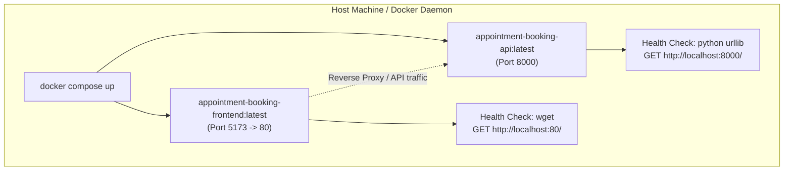

# Docker Containerization Guide — Role S8 (Docker Engineer)

## Overview
This document details the containerization architecture and deployment procedures engineered for the **Client Appointment Booking System** (Role S8). The solution provides secure, lightweight, production-grade Docker images for both the **FastAPI REST API backend** and the **React (Vite) frontend application**, along with full-stack orchestration via **Docker Compose**.

---

## Architecture & Container Design



---

## 1. Backend Docker Containerization (`Dockerfile`)

### Key Design Highlights:
* **Multi-Stage Build Pattern**:
  * **Stage 1 (`builder`)**: Installs Python dependencies in isolation (`pip install --user --no-cache-dir`). Compilers and pip caches are discarded.
  * **Stage 2 (`runner`)**: Uses `python:3.9-slim` as the clean base runtime. Only installed wheels from the builder stage and required application code (`main.py`, `models.py`, `routers/`) are copied.
* **Security & Non-Root Execution**:
  * Adheres to the principle of least privilege by creating a dedicated unprivileged user (`appuser` with UID `1001` and GID `1001`).
  * Application runs entirely as `USER appuser`, mitigating root breakout vulnerabilities.
* **Optimized Python Environment**:
  * `PYTHONDONTWRITEBYTECODE=1`: Prevents `.pyc` clutter in ephemeral containers.
  * `PYTHONUNBUFFERED=1`: Ensures real-time stdout/stderr log output for Docker log collectors and Kubernetes.
* **Built-in Self-Healing Healthcheck**:
  * Runs every 30 seconds using Python's standard `urllib.request` library. Zero external dependencies (`curl`, `wget`) needed in the backend image.
* **Exec Form Entrypoint**:
  * `CMD ["uvicorn", "main:app", "--host", "0.0.0.0", "--port", "8000"]` ensures PID 1 signal propagation for graceful `SIGTERM` container termination.

---

## 2. Build Context Optimization (`.dockerignore`)

The `.dockerignore` file prevents non-essential and sensitive files from entering the Docker build context:
* Eliminates Git history (`.git/`) and virtual environments (`venv/`, `.venv/`).
* Excludes test suites (`test_*.py`, `.pytest_cache/`) and coverage reports from production images.
* Excludes local node modules (`frontend/node_modules/`) and documentation (`docs/`, `*.md`).
* Prevents leaking local secrets (`.env*`, `*.pem`, `*.key`).

---

## 3. Frontend Containerization (`frontend/Dockerfile` & `nginx.conf`)

* **Multi-stage Node + Nginx build**:
  * **Stage 1**: `node:20-alpine` builds optimized static assets via `npm ci && npm run build`.
  * **Stage 2**: `nginx:alpine` serves static files with Gzip compression and long-lived cache headers for assets.
* **SPA Routing Fallback**: `try_files $uri $uri/ /index.html;` ensures React Router client-side routes (e.g. `/book`, `/clients`, `/admin`) reload without 404 errors.
* **API Reverse Proxy**: Automatically proxies `/clients`, `/appointments`, and `/admin` requests to `http://api:8000`.

---

## 4. Multi-Container Orchestration (`docker-compose.yml`)

Start the entire full-stack system with a single command:

```bash
docker compose up --build
```

### Services Summary:
| Service | Image | Internal Port | Host Port | Health Check |
|---|---|---|---|---|
| **api** | `appointment-booking-api:latest` | 8000 | 8000 | `http://localhost:8000/` via Python |
| **frontend** | `appointment-booking-frontend:latest` | 80 | 5173 | `http://localhost:80/` via wget |

---

## 5. Command Reference

### Build and Run Backend API Manually:
```bash
# Build image
docker build -t appointment-booking-api:v1.0.0 .

# Run container with port forwarding and restart policy
docker run -d --name appointment-api -p 8000:8000 appointment-booking-api:v1.0.0

# Inspect health check status
docker inspect --format='{{json .State.Health.Status}}' appointment-api

# View container logs
docker logs -f appointment-api

# Stop and remove container
docker stop appointment-api && docker rm appointment-api
```

### Full Stack with Docker Compose:
```bash
# Build and launch all services in detached mode
docker compose up -d --build

# View container status and health
docker compose ps

# Follow logs across all services
docker compose logs -f

# Shut down all services and remove network
docker compose down
```
