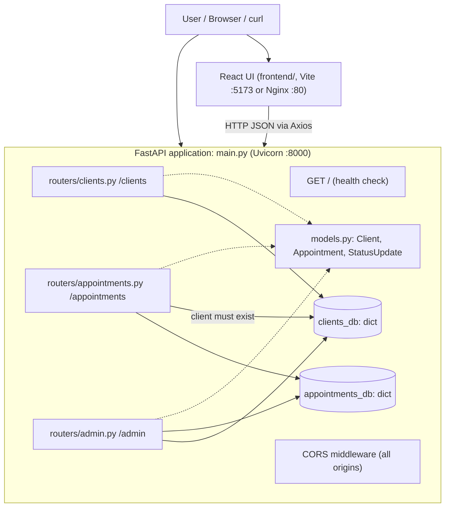
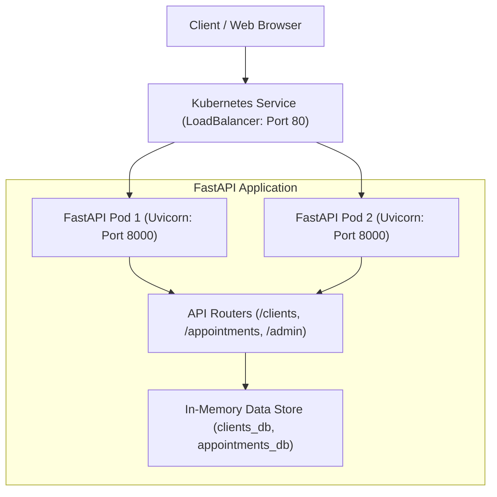
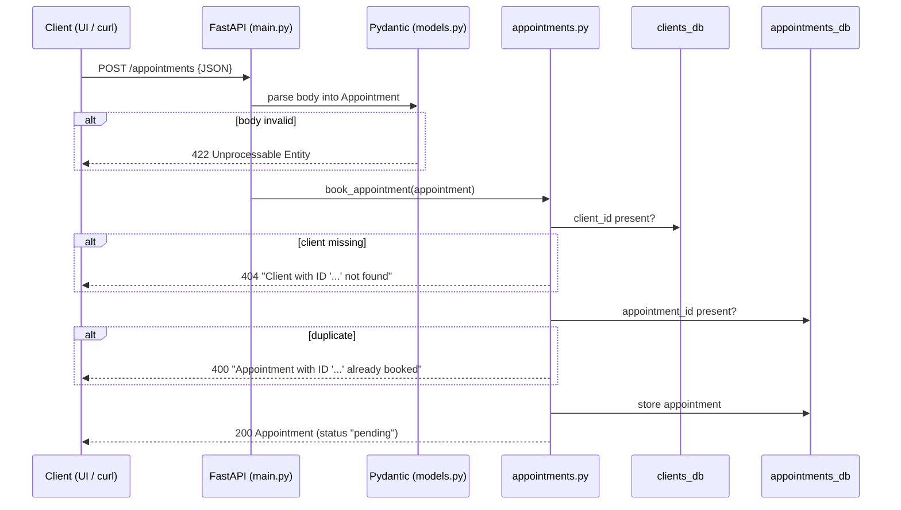
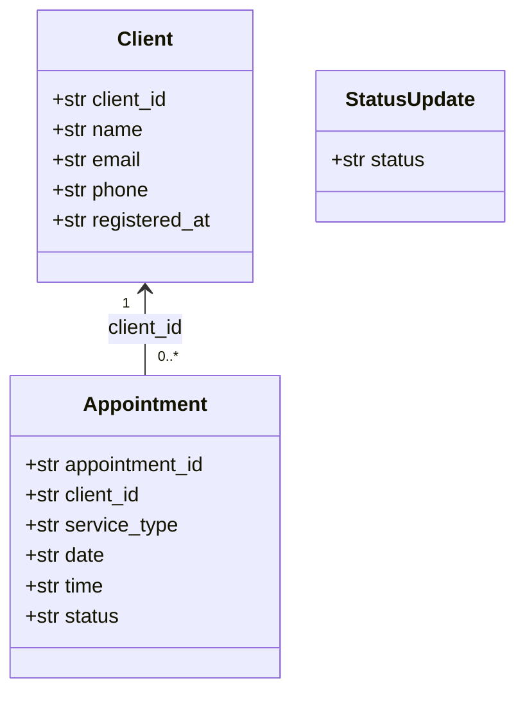
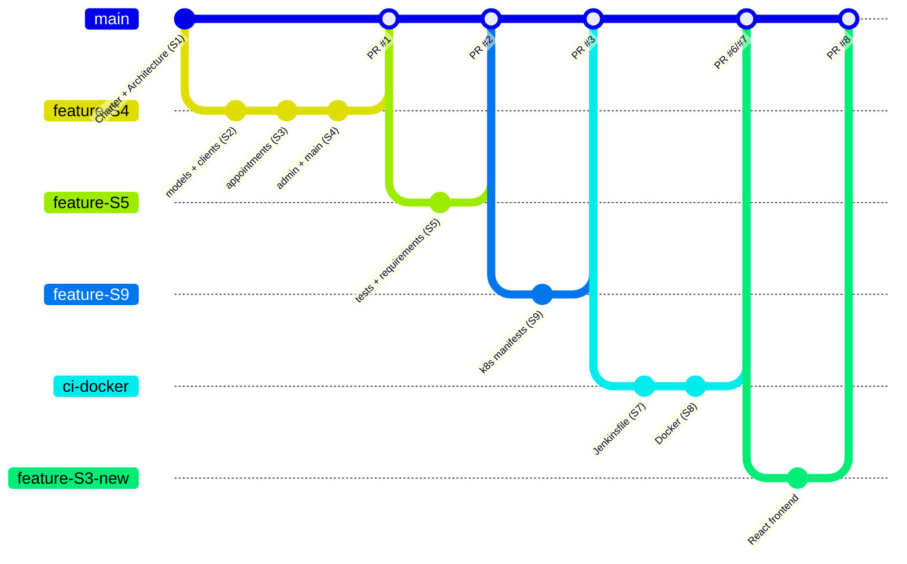

# Project Architecture & System Design

> **Owner:** Shweta Lokhande (2303059), Team Lead (Role S1). Original version: commits `b4d14db`, `c7031c0`, `ae55897` (2026-10-07).
> **Expanded:** 2026-10-12 by Vighnesh Shinde (2303057, Role S10), in coordination with the Team Lead. Every statement below was checked against the code on branch `feature/1` (commit `b5030ce`). Anything that is configured but **not verified by execution** is labelled.

---

## 1. Project Title & Objective

**Client Appointment Booking System** is a REST API that registers clients, books appointments for them, and gives administrators tools to manage those appointments. A React web interface (*AppointmentHub*) sits on top of the API.

**Objective:** build a small, modular, well-tested web service and take it through a complete DevOps workflow: version control with Git/GitHub, automated testing with Pytest, CI/CD with Jenkins, containerization with Docker, and orchestration with Kubernetes.

## 2. Problem Statement

Small service providers (clinics, salons, consultants) often track bookings on paper or in spreadsheets. This causes duplicate or lost bookings, no central client list, and no quick overview of how many appointments are pending, confirmed or cancelled. The system provides a single API that:

- keeps a registry of clients with unique IDs,
- refuses bookings for clients who do not exist,
- refuses duplicate appointment IDs,
- lets an administrator change status, delete records and view summary statistics.

## 3. Scope & Key Features

**In scope (implemented and tested):**

| Module | Endpoints | Behaviour |
|---|---|---|
| System | `GET /` | Health check: `{"status": "ok", ...}` |
| Clients | `POST /clients`, `GET /clients`, `GET /clients/{client_id}` | Register (duplicate → `400`), list, get (missing → `404`) |
| Appointments | `POST /appointments`, `GET /appointments`, `GET /appointments/{appointment_id}` | Book (unknown client → `404`, duplicate → `400`, default status `pending`), list, get |
| Admin | `PUT /admin/appointments/{id}/status`, `DELETE /admin/appointments/{id}`, `DELETE /admin/clients/{id}`, `GET /admin/dashboard` | Change status, delete appointment, delete client **and their appointments**, counts by status |
| Validation | all `POST`/`PUT` bodies | Missing or wrongly-typed fields → `422` (Pydantic) |
| Web UI | `frontend/` | 7 React pages calling the endpoints above |

**Out of scope (not implemented):** authentication/authorization, a database, notifications, time-slot conflict checks, and format validation of e-mail, date, time and status.

## 4. Technology Stack

| Layer | Technology (version) | Purpose / why chosen |
|---|---|---|
| **API framework** | FastAPI 0.103.1 (Python; image uses 3.9, tested with 3.11) | Concise routing, automatic request validation, and auto-generated OpenAPI/Swagger docs at `/docs`. The endpoint handlers in this project are ordinary synchronous functions (`def`); FastAPI runs them in a thread pool. |
| **Data validation** | Pydantic 2.3.0 | Declares `Client`, `Appointment` and `StatusUpdate`; rejects invalid input with `422`; strips whitespace |
| **ASGI server** | Uvicorn 0.23.2 | Serves the FastAPI app on port 8000 |
| **Testing** | Pytest 7.4.2 + HTTPX 0.25.0 | `fastapi.testclient.TestClient` (built on HTTPX) sends real HTTP requests to the app in-process |
| **Web UI** | React 18 + Vite 5 + Tailwind CSS 3 + Axios | Optional browser front-end (`frontend/`) |
| **Version control** | Git & GitHub | Feature branches and pull requests |
| **CI/CD** | Jenkins (declarative `Jenkinsfile`) | Install → test → compile check → image build → deploy |
| **Containerization** | Docker (multi-stage), Docker Compose, Nginx | Reproducible API and UI images; one-command full stack |
| **Orchestration** | Kubernetes (`Deployment`, `Service`) | 2 API replicas, rolling updates, health probes, stable endpoint |

## 5. System Architecture

### 5.1 Logical architecture (application)

### 5.2 Deployment architecture (Kubernetes, as configured)

This is Shweta's original high-level diagram, kept as the target deployment view.

> ⚠️ **Design caveat:** each pod is a separate Python process with its **own** `clients_db` and `appointments_db`. The diagram shows one store for simplicity, but in reality there are two independent stores, and the Service may send consecutive requests to different pods. A shared database is required before running more than one replica in production (see §16).

## 6. Application Components & Responsibilities

| Component | File | Responsibility | Role |
|---|---|---|---|
| Entry point | `main.py` | Creates `FastAPI(title=..., version="1.0.0")`, adds CORS, includes the 3 routers, defines `GET /`; `python main.py` starts Uvicorn on `0.0.0.0:8000` | S4 |
| Data models | `models.py` | `Client` (5 required strings), `Appointment` (5 required strings + `status` default `"pending"`), `StatusUpdate` (`status`) | S2 |
| Clients router | `routers/clients.py` | Owns `clients_db`; register, list, get-by-ID | S2 |
| Appointments router | `routers/appointments.py` | Owns `appointments_db`; imports `clients_db` to verify the client; book, list, get-by-ID | S3 |
| Admin router | `routers/admin.py` | Imports both stores; status update, deletions (with cascade), dashboard | S4 |
| Tests | `test_main.py`, `test_appointments.py` | 9 + 10 HTTP-level tests | S5 / S3 |
| UI | `frontend/` | React pages; `src/api/client.js` wraps every endpoint (base URL `VITE_API_URL`, default `http://localhost:8000`) | extra (S3 member) |

**Dependency direction:** `main` → routers → `models`. `appointments` → `clients_db`. `admin` → both stores. Routers share state by importing each other's module-level dictionaries.

## 7. Request Flow

## 8. API Modules

| Module | Prefix | Swagger tag | Endpoints | Success / error codes |
|---|---|---|---|---|
| System | – | System | `GET /` | 200 |
| Client Management | `/clients` | Client Management | `POST ""`, `GET ""`, `GET /{client_id}` | 200 / 400, 404, 422 |
| Appointments | `/appointments` | Appointments | `POST ""`, `GET ""`, `GET /{appointment_id}` | 200 / 400, 404, 422 |
| Admin Management | `/admin` | Admin Management | `PUT /appointments/{id}/status`, `DELETE /appointments/{id}`, `DELETE /clients/{id}`, `GET /dashboard` | 200 / 404, 422 |

Collection routes are also registered with a trailing slash (hidden from the schema) so that `/clients/` and `/clients` both work. Successful creation returns `200`, not `201`. Full request and response examples are in the [README](../README.md#13-example-requests--responses).

## 9. Data Models & Persistence

- **Persistence:** none. The stores are module-level Python dictionaries (`dict[str, Client]`, `dict[str, Appointment]`) keyed by ID. Data lives only as long as the process.
- **Referential integrity:**
  - Enforced on create: an appointment needs an existing client.
  - Enforced on client delete: the client's appointments are removed too.
- **Not validated:** e-mail format, date/time format, allowed status values. Any status string is accepted; the dashboard only counts `pending`, `confirmed` and `cancelled`, ignoring case.

## 10. Testing Approach

| Suite | App under test | Count | Focus |
|---|---|---|---|
| `test_main.py` | full app from `main.py` | 9 | Health, client CRUD paths, booking, unknown client, dashboard, status update |
| `test_appointments.py` | a test app with only the clients + appointments routers | 10 | Booking rules, default status, duplicates, lists, lookups, register-then-book, `422` |

- Both suites use an `autouse` fixture that clears the in-memory stores before and after every test, so tests are isolated.
- **Observed results (2026-10-12, Python 3.11, pinned deps):** `test_appointments.py` passes (10/10) on the committed code. `test_main.py` cannot be collected because of a `SyntaxError` introduced by merge `e688f27` (see §17). With those stray lines removed, **19/19 pass**.
- **Gaps:** the delete endpoints and the `cancelled` dashboard count have no tests; no coverage tool is configured.

## 11. Git & GitHub Workflow

**As practised** (from the history; see [TEAM_CONTRIBUTION_AUDIT.md](TEAM_CONTRIBUTION_AUDIT.md)):

*Branch names use `-` instead of `/` for diagram compatibility (for example `feature-S4` = `feature/S4`). In this diagram `main` represents the repository's actual default and integration branch, **`feature/1`**. `ci-docker` represents the repository's `main` branch, where the Jenkins and Docker commits were made. Mermaid's gitGraph requires the first branch to be called `main`.*

- Each module was developed on its own branch and merged into `feature/1` through a **pull request** (8 PRs, 6 merged).
- The planned policy (Team Charter) was GitFlow with a protected `main` and a `develop` branch. In practice `feature/1` served as the integration branch, and reviews were not enforced.
- `.gitignore` excludes virtual environments, caches, `node_modules`, build output, `.env` files and keys.

## 12. Jenkins CI/CD Workflow

Configured in [`Jenkinsfile`](../Jenkinsfile) (declarative pipeline, Windows agent, `bat` steps).

```mermaid
graph LR
    DevPush["Developer push / PR merge"] --> GitHub["GitHub repository"]
    GitHub -.->|manual Build Now or job-level trigger, not in Jenkinsfile| Jenkins["Jenkins pipeline"]
    Jenkins --> S1["1 Checkout"]
    S1 --> S2["2 Install Dependencies (pip)"]
    S2 --> S3["3 Run Tests (pytest, 19 tests)"]
    S3 --> S4["4 Code Quality Check (py_compile x5)"]
    S4 --> S5["5 Build Docker Image (vN + latest)"]
    S5 --> S6["6 Deploy to Kubernetes (kubectl apply)"]
    S6 --> Post["post: success / failure / always messages"]

    classDef soft stroke-dasharray: 5 5;
    class S5,S6 soft;
```

| Stage | Configured behaviour | Fails the build on error? |
|---|---|---|
| Checkout | `checkout scm` | Yes |
| Install Dependencies | `pip.exe install -r requirements.txt` | Yes |
| Run Tests | `pytest.exe test_main.py test_appointments.py -v --tb=short` | Yes |
| Code Quality Check | `python -m py_compile` on `main.py`, `models.py`, 3 routers | Yes |
| Build Docker Image | `docker build -t appointment-booking-api:v${BUILD_NUMBER} .` + tag `latest` | **No**: errors are caught and a "simulated" message is printed |
| Deploy to Kubernetes | `kubectl apply -f k8s/deployment.yaml` and `service.yaml` | **No**: errors are caught and a "simulated" message is printed |

**Verification status:**

- The `Jenkinsfile` hard-codes `PYTHON_PATH` to one Windows machine.
- Commit messages (`fdd701e`, `b12bd4d`, `e171605`, `3a41b90`) show it was iterated on a real Windows Jenkins node, but no console logs are stored, so successful runs are **not verified from the repository**.
- Stages 5–6 are shown dashed because they can report success without doing the work.
- On the current `feature/1` HEAD, stage 2 would fail (§17).
- Shweta's original CI/CD diagram (push → Jenkins → Pytest → Docker → K8s) is preserved in spirit above, with the install and quality stages that were added later.

## 13. Docker Image Build & Container Execution

**Backend ([`Dockerfile`](../Dockerfile)):**

1. `builder` stage (`python:3.9-slim`): `pip install --user -r requirements.txt`.
2. `runner` stage (`python:3.9-slim`): copies `/root/.local` → `/home/appuser/.local`, copies only `main.py`, `models.py` and `routers/`, creates non-root `appuser` (UID/GID 1001), `EXPOSE 8000`, `HEALTHCHECK` with Python `urllib` on `GET /`, `CMD ["uvicorn","main:app","--host","0.0.0.0","--port","8000"]`.
3. `.dockerignore` excludes `.git`, tests, `docs/`, `*.md`, `k8s/`, `Jenkinsfile`, venvs, `node_modules`, `.env*`, `*.pem` and `*.key`.

**Frontend ([`frontend/Dockerfile`](../frontend/Dockerfile)):** `node:20-alpine` runs `npm ci && npm run build`, then `nginx:alpine` serves `dist/` with SPA fallback and gzip. `nginx.conf` also proxies `/clients`, `/appointments` and `/admin` to `http://api:8000`.

**Compose ([`docker-compose.yml`](../docker-compose.yml)):** `api` (8000:8000) and `frontend` (5173:80) on the bridge network `appointment-network`; the frontend starts after the API is healthy.

> **Verification status:** not built during this review (Docker Engine was not running on the review machine). On the current HEAD the backend build fails at `pip install` and the frontend build at `npm ci` (§17). After the fix, `npm install` + `vite build` of the frontend source was verified locally.

## 14. Kubernetes Deployment & Service

| Resource | Name | Configuration |
|---|---|---|
| `Deployment` (apps/v1) | `appointment-booking-api` | `replicas: 2`; `RollingUpdate` (`maxSurge: 1`, `maxUnavailable: 0`, so no downtime during updates); container `appointment-booking-api:latest`, `imagePullPolicy: IfNotPresent`; port 8000; requests 100m/128Mi, limits 500m/256Mi; **readiness** probe `GET /` (5s delay, every 10s); **liveness** probe `GET /` (15s delay, every 20s) |
| `Service` (v1) | `appointment-booking-service` | `type: LoadBalancer`; selector `app: appointment-booking-api`; `port: 80` → `targetPort: 8000` |

**Workflow:**

1. Build the image locally.
2. Make it visible to the cluster (Docker Desktop shares it automatically; Minikube needs `minikube image load`; kind needs `kind load docker-image`).
3. `kubectl apply -f k8s/`.
4. The readiness probes gate traffic.
5. Access the app via the LoadBalancer IP or `kubectl port-forward service/appointment-booking-service 8080:80`.

> **Verification status:** manifests reviewed only; **not applied** to a cluster during this review, and no deployment evidence is stored in the repository. No image registry is configured, so the manifests work only with a locally loaded image.

## 15. Security & Configuration Considerations

| Topic | Current state |
|---|---|
| Secrets | None in the code or configuration. `.gitignore` and `.dockerignore` exclude `.env*`, `*.pem` and `*.key`. |
| Container user | Runs as non-root `appuser` (UID 1001) ✅ |
| Image size / attack surface | Multi-stage slim image; only app files copied ✅ |
| Authentication | **None**: `/admin/*` is open to anyone who can reach the API ❌ |
| CORS | `allow_origins=["*"]` with `allow_credentials=True`; fine for a lab, too permissive for production |
| Input validation | Types and required fields only; no format or enum validation |
| Resource limits | Defined in the K8s Deployment ✅ |
| Configuration | No environment variables are read by the backend; port 8000 is hard-coded. The UI reads `VITE_API_URL`. |
| Supply chain | Python dependencies pinned with `==`; frontend uses `^` ranges plus a lock file |

## 16. Limitations & Future Improvements

| Limitation | Improvement |
|---|---|
| In-memory data; lost on restart; inconsistent across 2 replicas | PostgreSQL + SQLAlchemy (or SQLite for single-instance demos); K8s `StatefulSet` or managed DB |
| No authentication | OAuth2/JWT with an admin role |
| Weak field validation | `EmailStr`, `date`/`time` types, `Literal` status |
| No slot-clash detection | Check `(date, time)` before booking |
| Client-supplied IDs | Server-generated UUIDs |
| Jenkins: Windows-only paths; Docker/K8s failures hidden | Docker-based agent; fail on errors; push images to a registry; GitHub webhook; run CI on every PR |
| No registry; `:latest` tag | Versioned tags (`v${BUILD_NUMBER}`) pushed to Docker Hub/GHCR and used in the Deployment |
| Delete endpoints untested; no coverage | More tests + `pytest-cov` |
| No observability | Structured logging, Prometheus metrics, Grafana dashboards |

## 17. Known Integration Defect (as of `b5030ce`)

Merge commit `e688f27` left Markdown code fences in `routers/admin.py` and `requirements.txt`, and invalid JSON in `frontend/package-lock.json`. Effects:

- the API cannot start;
- `test_main.py` cannot load;
- `pip install`, the Jenkins Install stage and both Docker builds fail.

The application logic itself is sound: with the stray lines removed, 19/19 tests pass. Fix steps are in [README §8](../README.md#8-known-issue-on-the-current-branch-read-first).

**Lesson:** this is exactly what a CI check on every pull request prevents.

---

## Related Documentation

- 📋 [Team Charter & Governance Documentation](./Team_Charter.md)
- 🔎 [Team Contribution Audit](./TEAM_CONTRIBUTION_AUDIT.md)
- 🐳 [Docker Containerization Guide](./Docker_Containerization_Guide.md)
- 📘 [README / User Guide](../README.md)
